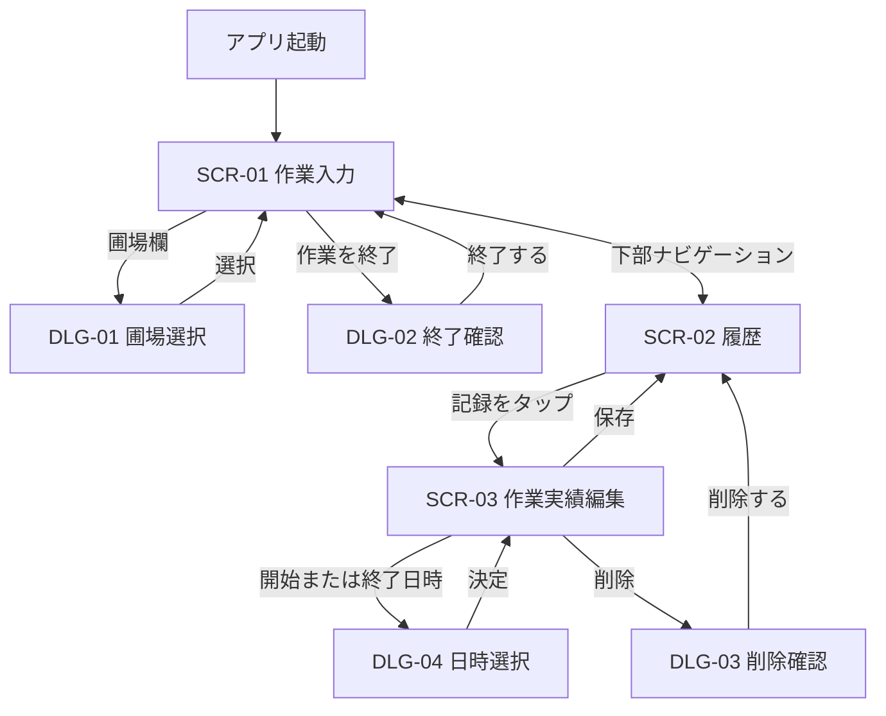

# 作業実績アプリ 画面設計書

## 1. 文書概要

### 目的

Android 15以降で動作する個人利用向け作業実績アプリについて、MVPで実装する画面、表示項目、操作、状態変化、入力チェックを定義します。

### 設計方針

- 圃場で片手でも操作できるよう、主要ボタンを大きくします。
- 通常の記録操作は「作業入力」画面だけで完了させます。
- 記録、修正、削除はオフラインでも実行できます。
- 通信は「データ送信」を押した場合だけ行います。
- 現在の作業状態と未送信件数を、画面を開いた直後に把握できるようにします。
- 色だけに依存せず、文字とアイコンでも状態を示します。

## 2. 画面一覧

| ID | 画面名 | 目的 | 主な遷移元 |
| --- | --- | --- | --- |
| `SCR-01` | 作業入力 | 圃場・作業内容の選択、開始、終了、データ送信 | アプリ起動、下部ナビゲーション |
| `DLG-01` | 圃場選択 | 固定された圃場候補から1件選択 | 作業入力 |
| `DLG-02` | 作業終了確認 | 作業の誤終了を防ぐ | 作業入力 |
| `SCR-02` | 履歴 | 過去の記録と送信状態を一覧表示 | 下部ナビゲーション |
| `SCR-03` | 作業実績編集 | 開始・終了日時の修正、記録の削除 | 履歴 |
| `DLG-03` | 削除確認 | 誤削除を防ぐ | 作業実績編集 |
| `DLG-04` | 日時選択 | 日付と時刻を修正する | 作業実績編集 |

## 3. 画面遷移



端末の戻る操作では、ダイアログから呼び出し元へ、編集画面から履歴へ戻ります。作業入力画面または履歴画面で戻るとアプリを終了します。作業中でも記録は端末に保存済みのため、終了確認は不要です。

## 4. 共通仕様

### 画面方向とレイアウト

- スマートフォンの縦向きを基本とします。
- 画面幅に追従する1カラム構成とします。
- システムのステータスバー、ナビゲーションバー、画面切り欠きと重ならない余白を確保します。
- 内容が画面に収まらない場合は縦スクロールできます。ただし下部ナビゲーションは固定します。

### 操作性

- タップ領域は最低48dpを確保します。
- 開始、終了、データ送信、保存は横幅いっぱいの主要ボタンとします。
- 入力欄には常時表示するラベルを付け、入力後も項目名が分かるようにします。
- 無効なボタンは見た目を薄くし、タップしても処理しません。
- 処理中は同じ操作を連続実行できないようにします。

### 表示形式

| 種別 | 表示例 |
| --- | --- |
| 日付 | `2026/10/01` |
| 時刻 | `08:30` |
| 日時 | `2026/10/01 08:30` |
| 経過時間 | `1時間15分`、24時間以上は `1日2時間15分` |
| 未送信件数 | `未送信 3件` |

端末内とサーバー間ではタイムゾーンを含む日時を使用し、画面上では端末のローカル時刻で表示します。

### 送信状態

| 内部状態 | 画面表示 | 意味 |
| --- | --- | --- |
| `pending` | 未送信 | 新規作成、修正または削除後で未送信 |
| `sending` | 送信中 | APIへ送信している途中 |
| `sent` | 送信済み | 最新の内容がサーバーへ反映済み |
| `failed` | 送信失敗 | 前回の送信に失敗し、再送が必要 |

## 5. `SCR-01` 作業入力画面

### 通常時のレイアウト

```text
┌────────────────────────────────┐
│ 作業実績                       │
│                                │
│ 圃場                           │
│ ┌────────────────────────────┐ │
│ │ 第1圃場                  ▼ │ │
│ └────────────────────────────┘ │
│                                │
│ 作業内容                       │
│ ┌────────────────────────────┐ │
│ │ 作業内容を入力             │ │
│ └────────────────────────────┘ │
│ 最近使った作業                 │
│ [草刈り] [水やり] [収穫]       │
│ [消毒] [施肥]                   │
│                                │
│ [          作業を開始          ] │
│                                │
│ 未送信 3件                      │
│ [          データ送信          ] │
│ 最終送信 2026/10/01 17:00      │
│                                │
├────────────────────────────────┤
│ ● 作業入力              履歴 ○ │
└────────────────────────────────┘
```

### 作業中のレイアウト

```text
┌────────────────────────────────┐
│ 作業実績                       │
│                                │
│ 作業中                         │
│ 第1圃場                        │
│ 草刈り                         │
│ 開始 2026/10/01 08:30          │
│ 経過 1時間15分                 │
│                                │
│ [          作業を終了          ] │
│                                │
│ 未送信 2件                      │
│ [          データ送信          ] │
│                                │
├────────────────────────────────┤
│ ● 作業入力              履歴 ○ │
└────────────────────────────────┘
```

### 表示項目・操作

| No. | 項目 | 種類 | 通常時 | 作業中 | 動作 |
| --- | --- | --- | --- | --- | --- |
| 1 | 圃場 | 選択欄 | 有効 | 作業情報内に表示 | タップで`DLG-01`を開く |
| 2 | 作業内容 | 1行テキスト入力 | 有効 | 作業情報内に表示 | 任意の作業名を入力する |
| 3 | 最近使った作業 | 候補チップ、最大5件 | 表示 | 非表示 | タップした文字を作業内容へ入力する |
| 4 | 作業を開始 | 主要ボタン | 条件成立時に有効 | 非表示 | 現在時刻で作業を開始する |
| 5 | 作業中情報 | 情報カード | 非表示 | 表示 | 圃場、作業内容、開始、経過時間を表示する |
| 6 | 作業を終了 | 警告色の主要ボタン | 非表示 | 有効 | `DLG-02`を開く |
| 7 | 未送信件数 | テキスト | 常時表示 | 常時表示 | 新規・修正・削除の未送信合計を表示する |
| 8 | データ送信 | 主要ボタン | 未送信がある場合に有効 | 未送信がある場合に有効 | 完了済みの未送信データを送る |
| 9 | 最終送信 | 補足テキスト | 送信実績がある場合に表示 | 同左 | 最後に全件の処理が完了した日時を表示する |
| 10 | 下部ナビゲーション | ナビゲーション | 常時表示 | 常時表示 | 作業入力と履歴を切り替える |

### 開始ボタンの有効条件

次をすべて満たす場合だけ有効にします。

1. 作業中の記録がない。
2. 圃場が選択されている。
3. 前後の空白を除いた作業内容が1文字以上ある。

開始時は確認を表示せず、現在日時と入力内容を直ちにRoomへ保存します。保存成功後に作業中表示へ切り替えます。保存失敗時は開始状態へ移行せず、「保存できませんでした。もう一度お試しください」と表示します。

### 直近5件の候補

- 削除されていない履歴を対象とします。
- 作業開始日時が新しい順に検索します。
- 同じ作業内容は1件として扱い、最大5件を表示します。
- 前後の空白を除いた文字列で重複を判定します。
- 履歴がない場合は候補見出しごと非表示にします。

### 経過時間

- 作業中は端末の現在時刻との差を1分単位で更新します。
- 画面を閉じている間は常時計測処理を動かさず、再表示時に保存済み開始日時から再計算します。
- 端末再起動後も保存済みの開始日時から復元します。

### データ送信

- 作業中の記録は送信対象外ですが、すでに完了している未送信記録は作業中でも送信できます。
- タップ後はボタン内を「送信中…」へ変更し、処理が終わるまで無効にします。
- オフラインの場合はAPIを呼ばず、画面下部に「インターネットに接続してから再度お試しください」と表示します。
- 全件成功時は「3件を送信しました」と表示します。
- 一部失敗時は「2件を送信しました。1件は送信できませんでした」と表示します。
- すべて失敗した場合は「送信できませんでした。時間をおいて再度お試しください」と表示します。
- 結果メッセージを閉じても、未送信件数と履歴の送信状態から結果を再確認できます。

## 6. `DLG-01` 圃場選択

```text
┌────────────────────────────┐
│ 圃場を選択                 │
│                            │
│ ○ 第1圃場                  │
│ ○ 第2圃場                  │
│ ○ 東圃場                   │
│ ○ 西圃場                   │
│ ○ ハウス1                  │
│                            │
│                 [キャンセル]│
└────────────────────────────┘
```

- 候補は「第1圃場」「第2圃場」「東圃場」「西圃場」「ハウス1」とします。
- 現在値には選択済み表示を付けます。
- 候補をタップすると値を反映して閉じます。
- キャンセルまたはダイアログ外のタップでは変更しません。

## 7. `DLG-02` 作業終了確認

```text
┌────────────────────────────┐
│ 作業を終了しますか？       │
│                            │
│ 第1圃場                    │
│ 草刈り                     │
│ 開始 2026/10/01 08:30      │
│                            │
│ [キャンセル] [終了する]    │
└────────────────────────────┘
```

- 「終了する」で現在日時を終了日時として端末へ保存します。
- 保存後は通常表示へ戻り、今回の作業内容を直近候補の先頭へ反映します。
- 「キャンセル」と戻る操作では作業を継続します。
- 二重タップを防ぐため、保存処理中はボタンを無効にします。

## 8. `SCR-02` 履歴画面

```text
┌────────────────────────────────┐
│ 履歴                           │
│                                │
│ 2026/10/01                     │
│ ┌────────────────────────────┐ │
│ │ 第1圃場                    │ │
│ │ 草刈り                     │ │
│ │ 08:30 ～ 09:45  1時間15分 │ │
│ │ 未送信                  ＞ │ │
│ └────────────────────────────┘ │
│                                │
│ 2026/09/30                     │
│ ┌────────────────────────────┐ │
│ │ 東圃場                      │ │
│ │ 収穫                        │ │
│ │ 13:00 ～ 15:10  2時間10分 │ │
│ │ 送信済み                ＞ │ │
│ └────────────────────────────┘ │
│                                │
├────────────────────────────────┤
│ ○ 作業入力              履歴 ● │
└────────────────────────────────┘
```

### 一覧仕様

- 削除されていない記録を開始日時の新しい順に表示します。
- 日付ごとに見出しを表示します。
- 1件ごとに圃場、作業内容、開始・終了時刻、作業時間、送信状態を表示します。
- 作業中の記録には終了時刻の代わりに「作業中」と表示します。
- 行全体をタップすると`SCR-03`を開きます。
- 件数が増えても一度に全件を描画せず、スクロールに応じて表示します。
- 履歴が0件の場合は「作業履歴はまだありません」と表示します。

## 9. `SCR-03` 作業実績編集画面

```text
┌────────────────────────────────┐
│ ＜  作業実績を編集             │
│                                │
│ 圃場                           │
│ 第1圃場                        │
│                                │
│ 作業内容                       │
│ 草刈り                         │
│                                │
│ 開始日時                       │
│ [ 2026/10/01 08:30          ＞]│
│                                │
│ 終了日時                       │
│ [ 2026/10/01 09:45          ＞]│
│                                │
│ [             保存             ]│
│                                │
│ [         この記録を削除       ]│
└────────────────────────────────┘
```

### 編集仕様

- MVPでは圃場と作業内容を参照表示とし、開始・終了日時だけを修正対象とします。
- 開始日時または終了日時をタップすると`DLG-04`を開きます。
- 作業中の記録では終了日時を「未終了」と表示します。作業中の終了日時修正はできません。
- 変更がない場合、保存ボタンは無効にします。
- 保存後は `updated_at` を更新し、`sync_status` を `pending` にします。
- 保存完了後は履歴へ戻り、「変更を保存しました」と表示します。
- 未保存の変更がある状態で戻る場合は、破棄確認を表示します。

### 入力チェック

| 条件 | メッセージ |
| --- | --- |
| 終了日時が開始日時と同じ、または前 | `終了日時は開始日時より後にしてください` |
| 開始日時または終了日時が現在より後 | `未来の日時は指定できません` |
| 保存処理に失敗 | `保存できませんでした。もう一度お試しください` |

送信済み記録を変更した場合も未送信へ戻し、次回のデータ送信でMySQL側の同じUUIDを更新します。

## 10. `DLG-03` 削除確認

```text
┌────────────────────────────┐
│ この記録を削除しますか？   │
│                            │
│ 2026/10/01 08:30～09:45    │
│ 第1圃場 / 草刈り           │
│                            │
│ この操作は元に戻せません。 │
│                            │
│ [キャンセル] [削除する]    │
└────────────────────────────┘
```

- 「削除する」で端末上の履歴から非表示にします。
- 未送信の新規記録は端末DBから削除できます。
- 一度でも送信した記録は `deleted_at` を設定して未送信とし、サーバーへ削除情報が送られるまで端末DBへ保持します。
- 削除完了後は履歴へ戻り、「記録を削除しました」と表示します。

## 11. `DLG-04` 日時選択

- Android標準に沿った日付選択と時刻選択を順に表示します。
- 初期値には現在保存されている日時を設定します。
- 決定するまでデータベースは更新しません。
- 日時を選んだ時点で不正な前後関係になっていても編集画面に戻れますが、項目下にエラーを表示し、修正されるまで保存を無効にします。

## 12. 状態別の制御一覧

| 状態 | 開始 | 終了 | データ送信 | 履歴編集 |
| --- | --- | --- | --- | --- |
| 通常・入力不足 | 無効 | 非表示 | 未送信があれば有効 | 可能 |
| 通常・入力済み | 有効 | 非表示 | 未送信があれば有効 | 可能 |
| 作業中 | 非表示 | 有効 | 完了済みの未送信があれば有効 | 作業中記録の日時修正は不可 |
| オフライン | 通常どおり | 通常どおり | 押下後に接続案内 | 可能 |
| 送信中 | 状態に従う | 状態に従う | 無効 | 可能 |
| 保存中 | 無効 | 無効 | 無効 | 対象操作を無効 |

## 13. アクセシビリティと屋外利用

- システムの文字サイズ設定を反映し、大きな文字でも主要操作が欠けないようスクロール可能にします。
- ボタン、入力欄、候補には読み上げ可能なラベルを付けます。
- 送信状態は色だけでなく「未送信」「送信済み」などの文字で示します。
- 開始と終了は位置、文言、色を変え、取り違えにくくします。
- 直射日光下を考慮し、文字と背景のコントラストを確保します。
- ダークテーマでも読み取れる配色にします。

## 14. 受け入れ条件

### 作業記録

- 圃場と作業内容を指定すると作業を開始できる。
- 作業内容が空の場合は開始できない。
- 同時に2件の作業を開始できない。
- オフラインで開始・終了できる。
- アプリ終了または端末再起動後も作業中状態を復元できる。
- 終了した作業内容が直近5件の候補へ重複なく表示される。

### 履歴・編集・削除

- 履歴が開始日時の新しい順で表示される。
- 開始・終了日時を修正でき、不正な日時は保存できない。
- 記録を確認付きで削除できる。
- 送信済み記録を修正・削除すると未送信件数へ反映される。

### データ送信

- オフライン時に端末データを失わず、接続案内が表示される。
- 新規・修正・削除を同じ送信操作でサーバーへ反映できる。
- 一部失敗時は成功した記録だけ送信済みになる。
- 同じUUIDを再送してもMySQLに重複登録されない。
- 送信結果と残りの未送信件数を画面で確認できる。
